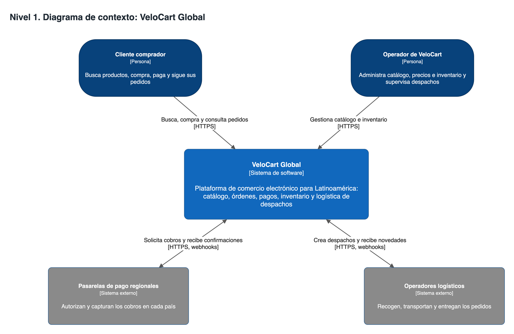
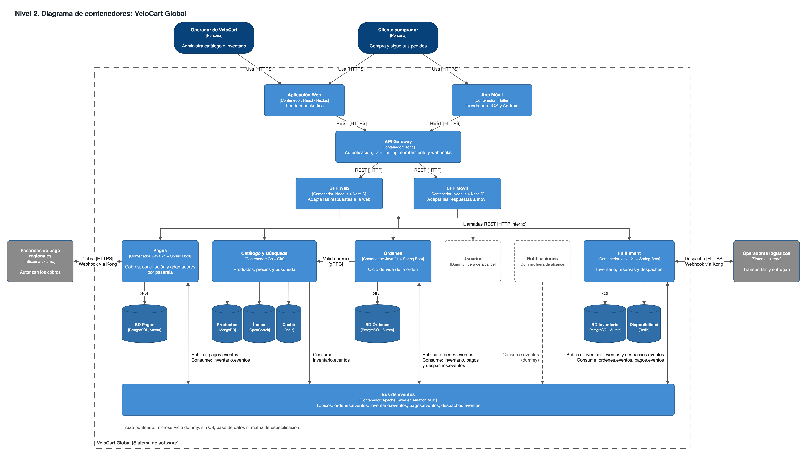
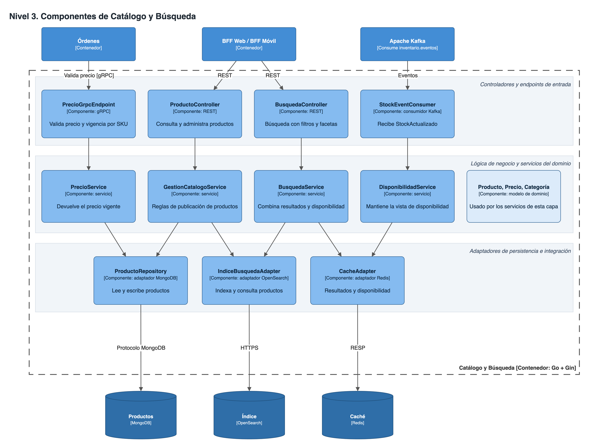
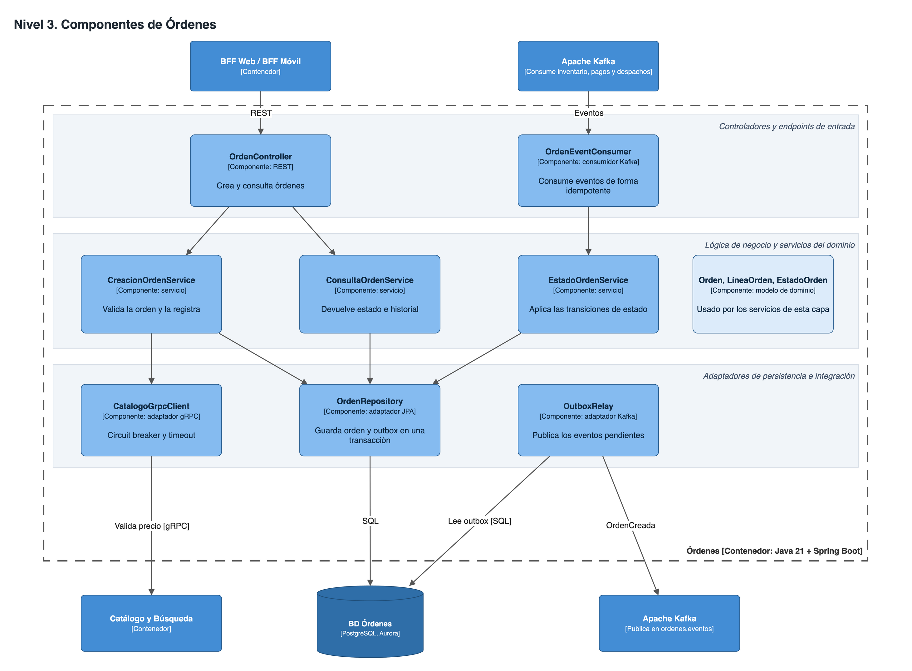
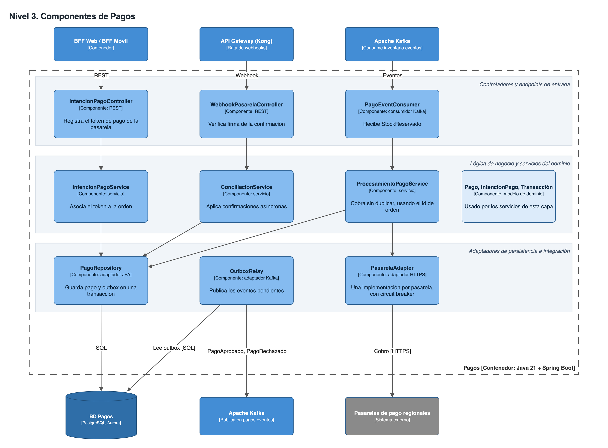
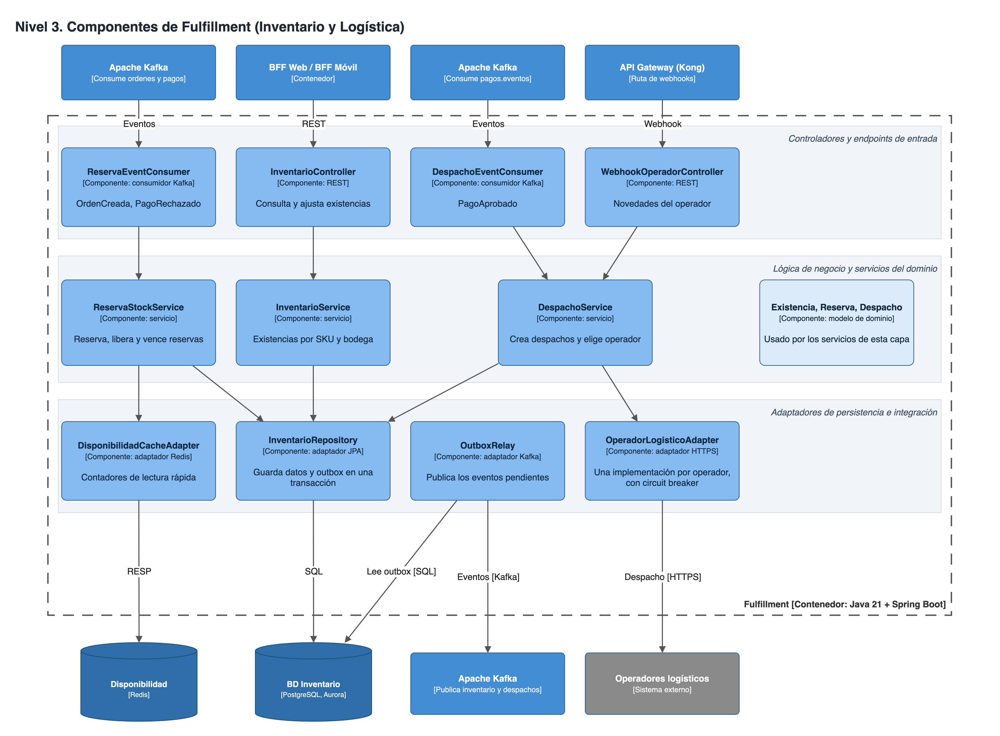

# Arquitectura de Microservicios para VeloCart Global

**Universidad Autónoma de Bucaramanga (UNAB) · Arquitectura de Software**  
**Profesor:** MSc. Feisar Moreno  
**Integrantes:** Santiago Ruiz y Juan Calderon

## Entregable principal

### 📄 [Abrir el informe en PDF](informe/Informe-Arquitectura-VeloCart.pdf)

El PDF es el documento que se entrega y contiene todo lo que pide el taller. Tiene 15 páginas: los diagramas están en A3 horizontal, y el resto en A4. Si la vista previa de GitHub se ve pequeña, usa el botón de descarga.

## Dónde está cada requisito

| Requisito del taller | Página del PDF | También disponible en |
|---|---|---|
| Descripción del sistema | 2 | [Informe en Markdown](informe/informe-velocart.md#11-descripción-del-sistema) |
| Definición de los Bounded Contexts | 2 | [Informe en Markdown](informe/informe-velocart.md#12-bounded-contexts-identificados) |
| Justificación del estilo de comunicación por interacción | 2 a 4 | [Informe en Markdown](informe/informe-velocart.md#13-justificación-del-estilo-de-comunicación) |
| C4 Nivel 1: contexto | 5 | [Imagen](diagramas/png/c1-contexto.png) |
| C4 Nivel 2: contenedores | 6 | [Imagen](diagramas/png/c2-contenedores.png) |
| C4 Nivel 3: Catálogo y Búsqueda | 7 | [Imagen](diagramas/png/c3-catalogo.png) |
| C4 Nivel 3: Órdenes | 8 | [Imagen](diagramas/png/c3-ordenes.png) |
| C4 Nivel 3: Pagos | 9 | [Imagen](diagramas/png/c3-pagos.png) |
| C4 Nivel 3: Fulfillment | 10 | [Imagen](diagramas/png/c3-fulfillment.png) |
| Matriz de orquestación y plataforma central | 11 y 12 | [Informe en Markdown](informe/informe-velocart.md#31-infraestructura-de-orquestación-y-plataforma-central) |
| Matriz de software y hardware por microservicio | 12 a 15 | [Informe en Markdown](informe/informe-velocart.md#32-catálogo-y-búsqueda) |

## La solución en breve

El monolito se divide en cuatro microservicios, cada uno con su propia base de datos y escalado independiente.

| Microservicio | Responsabilidad | Stack | Datos | Perfil de hardware |
|---|---|---|---|---|
| Catálogo y Búsqueda | Productos, precios y búsqueda | Go + Gin | MongoDB, OpenSearch, Redis | Optimizado para cómputo |
| Órdenes | Ciclo de vida de la orden | Java 21 + Spring Boot | PostgreSQL (Aurora) | Propósito general |
| Pagos | Cobros y conciliación con pasarelas | Java 21 + Spring Boot | PostgreSQL (Aurora) | Propósito general |
| Fulfillment | Inventario, reservas y despachos | Java 21 + Spring Boot | PostgreSQL (Aurora), Redis | Optimizado para memoria |

**Plataforma:** AWS en São Paulo, Amazon EKS, Kong con BFF Web y BFF Móvil, Apache Kafka en Amazon MSK, y OpenTelemetry con Prometheus, Grafana, Loki y Tempo. No se usa Service Mesh; la justificación está en la matriz de plataforma.

**Decisiones a tener en cuenta:**

- Inventario y Logística se agrupan en Fulfillment; la razón está en la sección 1.2 del informe.
- Usuarios y Notificaciones son servicios *dummy*: aparecen en el diagrama de contenedores, punteados, y están fuera del alcance.
- El caso no da volúmenes de tráfico, así que las cifras de hardware y autoescalado son valores iniciales estimados por el equipo.

## Diagramas

### Nivel 1: contexto



### Nivel 2: contenedores



### Nivel 3: componentes

<details>
<summary><strong>Catálogo y Búsqueda</strong></summary>



</details>

<details>
<summary><strong>Órdenes</strong></summary>



</details>

<details>
<summary><strong>Pagos</strong></summary>



</details>

<details>
<summary><strong>Fulfillment</strong></summary>



</details>

Para editar los diagramas, abre [`velocart-c4.drawio`](diagramas/velocart-c4.drawio) en [draw.io](https://app.diagrams.net). Tiene una página por diagrama.

## Estructura del repositorio

```text
├── README.md
├── informe/
│   ├── Informe-Arquitectura-VeloCart.pdf   Entregable final
│   ├── informe-velocart.md                 Fuente del informe
│   ├── estilos.css                         Estilos del PDF
│   └── generar-pdf.sh                      Regenera el PDF (requiere pandoc y Chrome)
├── diagramas/
│   ├── velocart-c4.drawio                  Diagramas editables
│   └── png/                                Diagramas exportados
└── enunciado/
    ├── arquitectura-microservicios-velocart.md   Caso de estudio y requisitos
    └── arquitectura-microservicios.md            Material de contexto del curso
```
