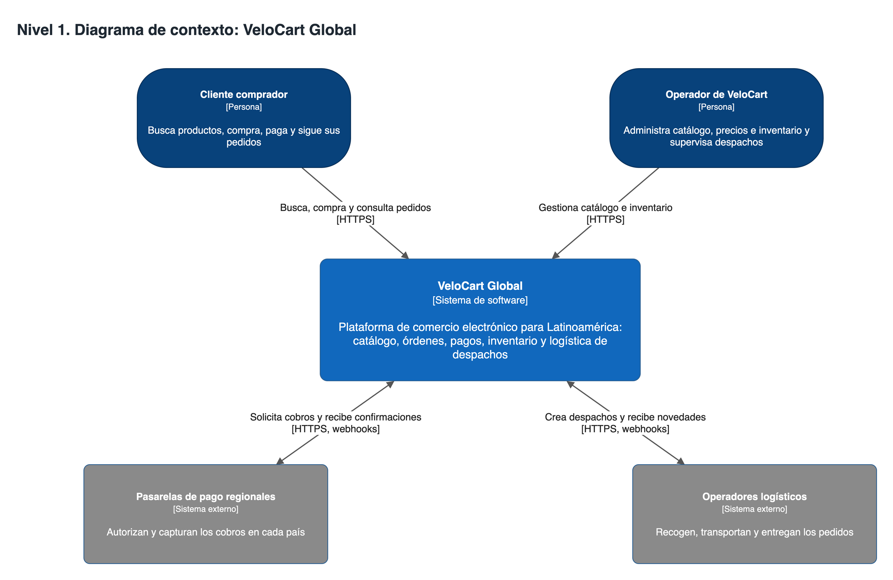
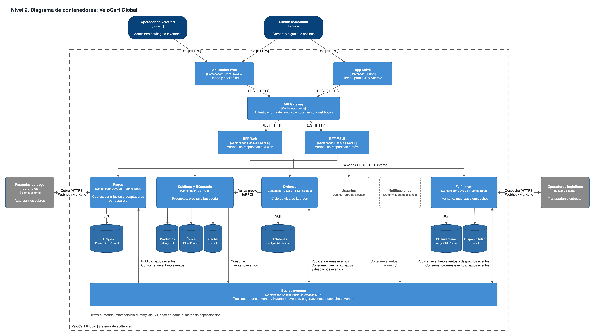
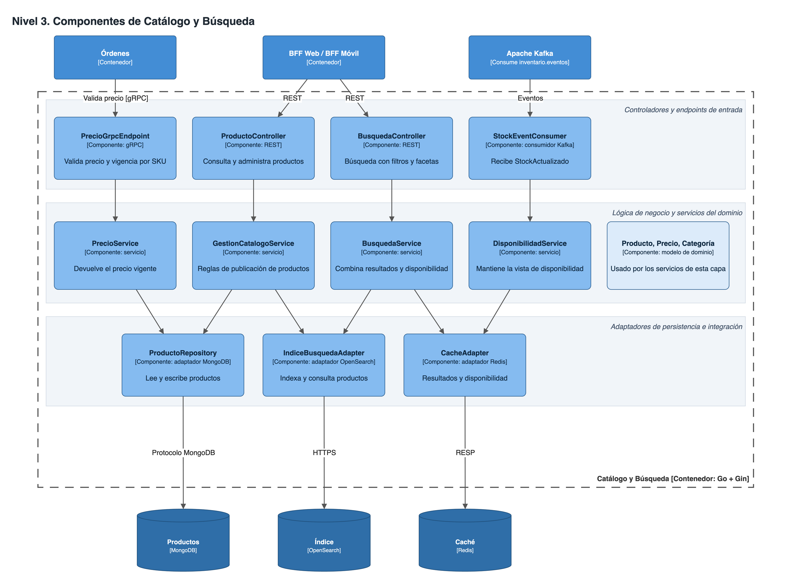
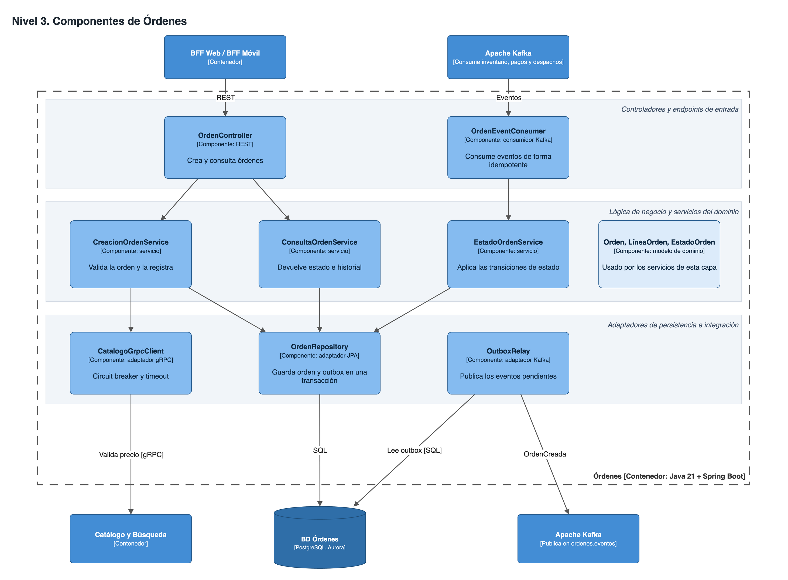
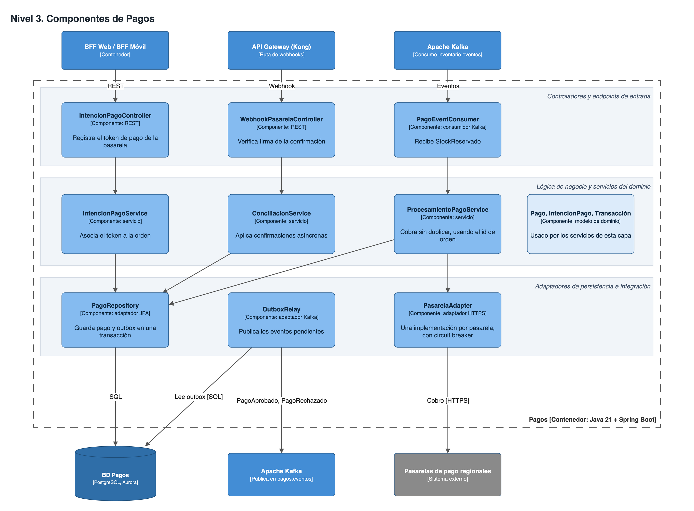
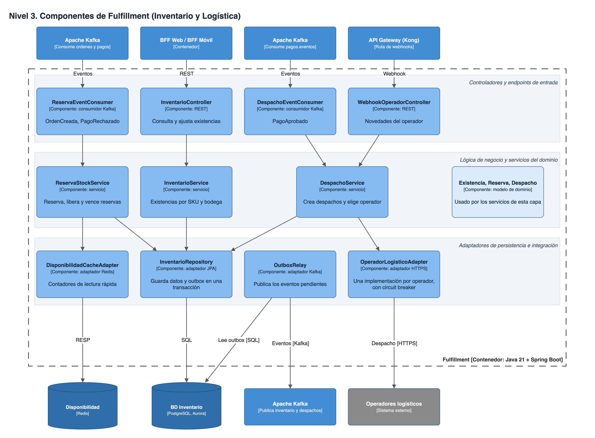

<section class="portada">

Universidad Autónoma de Bucaramanga (UNAB)

Arquitectura de Software

<h1 class="titulo">Arquitectura de Microservicios para VeloCart Global</h1>

Informe de arquitectura

<strong>Integrantes</strong> Santiago Ruiz Juan Calderon

<strong>Profesor</strong> MSc. Feisar Moreno

Noviembre de 2026

</section>

# 1. Documento de diseño arquitectónico

## 1.1 Descripción del sistema

VeloCart Global es una corporación de comercio electrónico con presencia en Latinoamérica. Hoy opera con un monolito que centraliza el catálogo, las órdenes, los pagos, el inventario y la logística de despachos. Esta concentración le genera tres problemas:

- **Caídas en ventas masivas.** En jornadas como CyberMonday o Black Friday, el tráfico de búsqueda y catálogo agota los recursos, y la base de datos relacional central acopla a todos los módulos.
- **Despliegues lentos.** Un cambio menor exige largas sesiones de pruebas y ventanas de mantenimiento nocturnas, justo cuando la empresa integra nuevas pasarelas y operadores.
- **Fallas sin aislar.** Los componentes externos comparten destino con el resto de la plataforma.

La arquitectura propuesta divide el sistema en microservicios con despliegue independiente y base de datos propia. Cada servicio escala por separado, de modo que un pico de búsquedas no consume los recursos de las compras. La comunicación entre dominios se hace principalmente por eventos, y cada integración externa queda aislada detrás de un adaptador con circuit breaker.

El alcance de este documento es el diseño; no incluye código fuente.

## 1.2 Bounded Contexts identificados

Se definen cuatro contextos delimitados, cada uno implementado por un microservicio completo.

| Bounded Context | Microservicio | Responsabilidad | Datos de los que es dueño | Lenguaje del dominio |
|---------------|-------------|----------------------------|------------------------|--------------------|
| Catálogo y Búsqueda | Catálogo y Búsqueda | Publicar productos, mantener precios y resolver búsquedas | Productos, precios, categorías, índice de búsqueda | Producto, SKU, categoría, faceta |
| Órdenes | Órdenes | Registrar la orden y seguir su ciclo de vida | Órdenes, líneas, historial de estados | Orden, línea, estado |
| Pagos | Pagos | Cobrar, conciliar con las pasarelas y aislarlas del resto | Intenciones de pago, pagos, transacciones | Intención, cobro, conciliación |
| Fulfillment | Fulfillment | Controlar existencias, reservar stock y gestionar despachos | Existencias, reservas, despachos | Existencia, reserva, despacho, operador |

**Por qué Inventario y Logística van juntos.** Se agrupan en Fulfillment porque ambos responden a la misma pregunta de negocio: cómo llega al cliente lo que compró. Un despacho consume directamente lo que se reservó. Si más adelante los equipos o la carga divergen, se pueden separar en dos servicios.

**Servicios dummy.** Usuarios y Notificaciones aparecen en el diagrama de contenedores solo para mostrar dónde encajarían. Están fuera del alcance: no tienen diseño interno, base de datos ni especificación.

## 1.3 Justificación del estilo de comunicación

**Criterio.** Se usa comunicación síncrona cuando quien llama necesita la respuesta para continuar. Se usan eventos cuando un dominio solo debe enterarse de algo que ocurrió en otro. Así, la caída de un servicio no se propaga en cascada a los demás.

### Interacciones síncronas

| Interacción | Protocolo | Justificación |
|------------------------|------------------|----------------------------------------------------------|
| Aplicación Web y App Móvil → API Gateway | REST sobre HTTPS | El usuario espera la respuesta en pantalla. REST es compatible con navegadores y móviles. |
| API Gateway → BFF Web y BFF Móvil | REST sobre HTTP interno | Cada cliente necesita datos distintos, y el BFF los adapta dentro de la misma petición. |
| BFF → Catálogo y Búsqueda | REST sobre HTTP interno | Las consultas son de lectura y requieren respuesta inmediata. |
| BFF → Órdenes | REST sobre HTTP interno | El cliente necesita confirmar que la orden quedó registrada y consultar su estado. |
| BFF → Pagos | REST sobre HTTP interno | El cliente debe saber que su intención de pago quedó registrada. El cobro ocurre después, por eventos; si `StockReservado` llega antes que el token, el cobro queda pendiente hasta recibirlo o hasta que venza la reserva. |
| BFF → Fulfillment | REST sobre HTTP interno | El operador consulta y ajusta existencias, y necesita ver el resultado en el momento. |
| Órdenes → Catálogo y Búsqueda | gRPC | No se puede registrar una orden sin validar el precio vigente. gRPC ofrece baja latencia y un contrato tipado. Con timeout y circuit breaker; si Catálogo no responde, la orden se rechaza con un error reintentable, porque no se debe vender a un precio sin validar. |
| Pagos → Pasarelas de pago | HTTPS | La pasarela solo ofrece API síncrona. Un circuit breaker por pasarela evita que una caída agote los hilos de Pagos. |
| Fulfillment → Operadores logísticos | HTTPS | El operador solo ofrece API síncrona. Un circuit breaker por operador contiene sus fallas. |
| Pasarelas y Operadores → Pagos y Fulfillment | Webhook HTTPS por una ruta dedicada de Kong | Es el mecanismo con el que estos sistemas informan resultados tardíos. Se verifica la firma de cada mensaje. |

### Interacciones asíncronas por eventos

Todos los eventos viajan por Apache Kafka. Las compras en pico quedan retenidas en el bus en vez de saturar a los consumidores, y cada servicio las procesa a su ritmo.

| Evento | Tópico | Productor | Consumidores | Justificación |
|---------------------|---------------------|----------|------------|------------------------------------|
| `OrdenCreada` | `ordenes.eventos` | Órdenes | Fulfillment | El cliente no debe esperar la reserva. Si Fulfillment está caído, la orden queda registrada y se procesa al recuperarse. |
| `StockReservado` | `inventario.eventos` | Fulfillment | Pagos, Órdenes | Solo se cobra lo que tiene stock. Pagos no necesita conocer a Fulfillment. |
| `StockInsuficiente` | `inventario.eventos` | Fulfillment | Órdenes | La orden se cancela sin que se haya intentado cobro alguno. |
| `StockActualizado` | `inventario.eventos` | Fulfillment | Catálogo y Búsqueda | Las búsquedas muestran disponibilidad sin llamar a Fulfillment. Un pico de búsquedas no llega a la base de inventario, a cambio de un breve desfase. |
| `PagoAprobado` | `pagos.eventos` | Pagos | Órdenes, Fulfillment | Una sola publicación actualiza la orden y dispara el despacho. |
| `PagoRechazado` | `pagos.eventos` | Pagos | Órdenes, Fulfillment | Cancela la orden y libera el stock reservado. También se publica si la pasarela sigue caída al agotar los reintentos. |
| `DespachoCreado` | `despachos.eventos` | Fulfillment | Órdenes | Actualiza el seguimiento sin acoplar a Órdenes con los operadores. |
| `DespachoActualizado` | `despachos.eventos` | Fulfillment | Órdenes | Traduce las novedades de cada operador a un único formato interno. |

**Garantías de entrega.** Dado que Kafka puede entregar un evento más de una vez, el diseño contempla tres mecanismos:

- **Outbox transaccional.** El servicio guarda el cambio y el evento en la misma transacción local, y un componente `OutboxRelay` lo publica después. Un evento no se pierde si Kafka falla justo tras la escritura.
- **Consumo idempotente.** Cada consumidor registra los identificadores de evento ya procesados.
- **Cobro sin duplicados.** Pagos usa el identificador de la orden como clave de idempotencia ante la pasarela.

<section class="diagrama primero">

# 2. Diagramas C4

Los diagramas se entregan también en formato editable en `diagramas/velocart-c4.drawio`.

## 2.1 Nivel 1: contexto

</section>

<section class="diagrama">

## 2.2 Nivel 2: contenedores

</section>

<section class="diagrama">

## 2.3 Nivel 3: componentes de Catálogo y Búsqueda

</section>

<section class="diagrama">

## 2.4 Nivel 3: componentes de Órdenes

</section>

<section class="diagrama">

## 2.5 Nivel 3: componentes de Pagos

</section>

<section class="diagrama">

## 2.6 Nivel 3: componentes de Fulfillment

</section>

# 3. Matriz de selección tecnológica

**Supuesto de dimensionamiento.** El caso no entrega volúmenes de tráfico. Por eso, las cifras de CPU, memoria, réplicas y umbrales son valores iniciales estimados por el equipo, y deben ajustarse con pruebas de carga antes de una jornada de ventas masivas.

## 3.1 Infraestructura de orquestación y plataforma central

| Componente | Selección | Justificación | Alternativa descartada |
|------------|------------------|------------------------------------------------|----------------------|
| Orquestación y contenedores | Docker, Amazon EKS (Kubernetes), HPA, KEDA y Karpenter | Permite desplegar y escalar cada servicio por separado, con recuperación automática de pods. KEDA escala según el lag de Kafka y Karpenter agrega nodos del perfil requerido durante los picos. | Amazon ECS: más simple, pero con menos opciones de escalado por métricas de eventos y mayor dependencia de AWS. |
| API Gateway | Kong, con un BFF Web y un BFF Móvil en NestJS | Centraliza autenticación, rate limiting y enrutamiento. El rate limiting protege a la plataforma en los picos. Cada BFF adapta las respuestas a su cliente. | Amazon API Gateway: menos control sobre plugins y costo por petición alto a gran volumen. |
| Aplicaciones cliente | Web en React con Next.js; móvil en Flutter | Next.js permite renderizar en servidor las páginas de catálogo, lo que mejora la carga inicial. Flutter comparte un solo código entre iOS y Android. | Apps nativas separadas: duplican el desarrollo. |
| Service Mesh | No se requiere | El tráfico este-oeste síncrono es reducido: los BFF hacia los servicios y Órdenes hacia Catálogo. Lo demás va por Kafka. Un mesh sumaría un sidecar por pod y más operación para poco tráfico. La resiliencia se resuelve con Resilience4j y el control de acceso con NetworkPolicies de Kubernetes. Debe reevaluarse (por ejemplo, con Linkerd) si aumentan las llamadas síncronas o se exige mTLS interno. | Istio: su costo operativo no se compensa con este volumen de llamadas. |
| Event Broker | Apache Kafka en Amazon MSK: 6 brokers en 3 zonas, factor de réplica 3 y 32 particiones por tópico | Retiene los eventos, absorbe picos y permite reprocesarlos, por ejemplo para reconstruir una caché. Las particiones limitan los consumidores paralelos, así que superan el máximo de réplicas de los servicios que escalan por eventos (30). Catálogo escala por tráfico HTTP hasta 60 réplicas: las que no reciben partición siguen atendiendo peticiones. Se usa como clave el id de orden, y el SKU en `StockActualizado`, para mantener el orden por entidad. | RabbitMQ: adecuado para colas de trabajo, pero sus colas clásicas eliminan el mensaje al consumirlo y no permiten reprocesarlo. |
| Observabilidad | OpenTelemetry, Prometheus, Grafana, Loki y Tempo | Las trazas distribuidas permiten seguir una compra entre servicios y eventos. Prometheus también aporta las métricas personalizadas que usa el autoescalado. Todas son abiertas y no atan la instrumentación a un proveedor. | Solo Amazon CloudWatch: menos capacidad para correlacionar métricas, logs y trazas entre servicios. |
| Hardware e infraestructura | AWS, región São Paulo (`sa-east-1`), 3 zonas de disponibilidad; nodos c7i, m7i y r7i | La nube ofrece la elasticidad que exigen los picos, sin comprar hardware que estaría ocioso el resto del año. São Paulo acerca la plataforma a Latinoamérica y las 3 zonas toleran la falla de una. Cada servicio usa el perfil de instancia acorde con su carga. | Servidores propios: requieren dimensionar para el pico todo el año. |

### Grupos de nodos de EKS

| Grupo | Instancia | Recursos por nodo | Perfil | Servicios |
|--------------|----------------|------------------|------------------------|----------------------------|
| Cómputo | `c7i.2xlarge` | 8 vCPU, 16 GiB | Optimizada para cómputo | Catálogo y Búsqueda |
| General | `m7i.2xlarge` | 8 vCPU, 32 GiB | Propósito general | Órdenes, Pagos, Kong, BFF |
| Memoria | `r7i.2xlarge` | 8 vCPU, 64 GiB | Optimizada para memoria | Fulfillment |

## 3.2 Catálogo y Búsqueda

| Aspecto | Especificación | Justificación |
|----------------|--------------------------------------|----------------------------------------------|
| **Software** | | |
| Lenguaje y framework | Go con Gin | Es el servicio con más tráfico. Go maneja mucha concurrencia con poca memoria por réplica, y su arranque rápido permite reaccionar a tiempo ante un pico. |
| Base de datos | Documental: MongoDB (fuente de verdad). Motor de búsqueda: Amazon OpenSearch. Caché en memoria: Amazon ElastiCache for Redis | Los atributos de un producto varían según la categoría, lo que encaja con documentos flexibles. La búsqueda de texto con facetas requiere un índice invertido. Las lecturas son mucho más que las escrituras y se repiten, por lo que la caché descarga los motores. El modelo de lectura se separa del de escritura. |
| Comunicación interna | gRPC (recibe de Órdenes), REST (recibe de BFF), Kafka (consume `inventario.eventos`) | gRPC cubre la validación de precio con baja latencia. Por Kafka recibe la disponibilidad sin depender de Fulfillment. |
| Comunicación externa | Ninguna directa; se expone por Kong y los BFF | El servicio no integra sistemas externos. |
| **Hardware** | | |
| Recursos por réplica | Solicita 1 vCPU y 1 GiB; límite de 2 vCPU y 2 GiB | La carga es sobre todo de CPU y el servicio no guarda estado. |
| Perfil de instancia | Optimizada para cómputo (`c7i.2xlarge`) | Serializar y combinar resultados consume más CPU que memoria. |
| Almacenamiento | Réplicas: sin disco persistente. MongoDB y OpenSearch: SSD EBS `gp3` con nodos de memoria alta (3 y 6 nodos de 8 vCPU y 64 GiB). Redis: en memoria, 3 fragmentos con réplica | Las réplicas son desechables. `gp3` permite ajustar IOPS sin cambiar el tamaño del disco. Redis se reconstruye desde las bases y desde Kafka. |
| Autoescalado horizontal | 6 a 60 réplicas. CPU promedio mayor a 60 % o más de 800 peticiones por segundo por réplica | El mínimo alto cubre el tráfico base en 3 zonas. Las peticiones por segundo anticipan el pico antes de que la CPU se sature. |

## 3.3 Órdenes

| Aspecto | Especificación | Justificación |
|----------------|--------------------------------------|----------------------------------------------|
| **Software** | | |
| Lenguaje y framework | Java 21 con Spring Boot | Ecosistema maduro para transacciones, con Spring Data JPA, Resilience4j y cliente de Kafka. |
| Base de datos | Relacional: PostgreSQL en Amazon Aurora | Una orden y sus líneas deben guardarse de forma atómica junto con su evento de outbox. Esto exige ACID e integridad referencial. Las réplicas de lectura atienden las consultas de estado. |
| Comunicación interna | REST (recibe de BFF), gRPC (llama a Catálogo), Kafka (publica `ordenes.eventos`; consume inventario, pagos y despachos) | La creación de la orden responde de inmediato al cliente, y el resto del proceso continúa por eventos. |
| Comunicación externa | Ninguna directa; se expone por Kong y los BFF | El servicio no integra sistemas externos. |
| **Hardware** | | |
| Recursos por réplica | Solicita 1 vCPU y 2 GiB; límite de 2 vCPU y 3 GiB | La JVM requiere memoria moderada, y buena parte del tiempo se espera a la base de datos. |
| Perfil de instancia | Propósito general (`m7i.2xlarge`) | La carga está equilibrada entre CPU y memoria. |
| Almacenamiento | Réplicas: sin disco persistente. Aurora: almacenamiento SSD distribuido en 3 zonas, con una instancia de escritura y 2 de lectura de 8 vCPU y 64 GiB | Aurora replica los datos entre zonas. Perder una orden es inaceptable. |
| Autoescalado horizontal | 4 a 30 réplicas. CPU promedio mayor a 65 % o latencia p95 mayor a 300 ms | La latencia refleja directamente lo que percibe el comprador al finalizar la compra. |

## 3.4 Pagos

| Aspecto | Especificación | Justificación |
|----------------|--------------------------------------|----------------------------------------------|
| **Software** | | |
| Lenguaje y framework | Java 21 con Spring Boot y Resilience4j | Resilience4j aporta circuit breaker y reintentos por pasarela. El patrón de puertos y adaptadores permite agregar una pasarela regional sin tocar el dominio. |
| Base de datos | Relacional: PostgreSQL en Amazon Aurora | Los pagos exigen ACID: un registro financiero no admite estados parciales. Se guardan solo los tokens de la pasarela, nunca los datos de tarjeta, lo que reduce el alcance de cumplimiento de PCI DSS. |
| Comunicación interna | REST (recibe de BFF), Kafka (publica `pagos.eventos`; consume `inventario.eventos`) | Registrar la intención es inmediato, pero el cobro se dispara por evento y no bloquea al comprador. |
| Comunicación externa | HTTPS hacia las pasarelas; webhooks firmados de entrada por Kong | Es el mecanismo que ofrecen las pasarelas. Los adaptadores contienen sus diferencias y sus fallas. |
| **Hardware** | | |
| Recursos por réplica | Solicita 1 vCPU y 2 GiB; límite de 2 vCPU y 3 GiB | Las llamadas a las pasarelas son principalmente espera de red. |
| Perfil de instancia | Propósito general (`m7i.2xlarge`) | No hay una carga dominante de CPU o memoria. |
| Almacenamiento | Réplicas: sin disco persistente. Aurora: almacenamiento SSD distribuido en 3 zonas, cifrado en reposo, con una instancia de escritura y 1 de lectura de 4 vCPU y 32 GiB | Los registros financieros requieren durabilidad entre zonas y cifrado. |
| Autoescalado horizontal | 3 a 20 réplicas. Más de 50 peticiones en curso por réplica o lag de Kafka mayor a 1 000 mensajes | Las peticiones en curso revelan pasarelas lentas, algo que la CPU no muestra. El lag indica cobros acumulados. |

## 3.5 Fulfillment

| Aspecto | Especificación | Justificación |
|----------------|--------------------------------------|----------------------------------------------|
| **Software** | | |
| Lenguaje y framework | Java 21 con Spring Boot y Resilience4j | Comparte las necesidades transaccionales de Órdenes y Pagos, y el patrón de adaptadores permite agregar operadores logísticos. |
| Base de datos | Relacional: PostgreSQL en Amazon Aurora (existencias y reservas, con bloqueo optimista). Caché en memoria: Amazon ElastiCache for Redis (contadores de disponibilidad) | Dos compradores no pueden reservar la misma unidad, y eso requiere transacciones y control de concurrencia. Cada reserva guarda su vencimiento y un proceso libera las vencidas. Redis responde las lecturas frecuentes sin cargar la base transaccional. |
| Comunicación interna | REST (recibe de BFF), Kafka (publica `inventario.eventos` y `despachos.eventos`; consume `ordenes.eventos` y `pagos.eventos`) | La reserva y el despacho se disparan por eventos, y así absorben los picos sin perder órdenes. |
| Comunicación externa | HTTPS hacia los operadores; webhooks firmados de entrada por Kong | Es el mecanismo que ofrecen los operadores. Cada adaptador traduce sus novedades a un formato único. |
| **Hardware** | | |
| Recursos por réplica | Solicita 1 vCPU y 4 GiB; límite de 2 vCPU y 6 GiB | Mantiene en memoria lotes de consumo de Kafka y datos de reservas en curso durante los picos. |
| Perfil de instancia | Optimizada para memoria (`r7i.2xlarge`) | La relación de 8 GiB por vCPU se ajusta a una carga limitada más por memoria que por CPU. |
| Almacenamiento | Réplicas: sin disco persistente. Aurora: almacenamiento SSD distribuido en 3 zonas, con una instancia de escritura y 1 de lectura de 8 vCPU y 64 GiB. Redis: en memoria, con réplica | Aurora es la fuente de verdad del stock. Redis puede reconstruirse desde ella. |
| Autoescalado horizontal | 4 a 30 réplicas. Lag de Kafka mayor a 2 000 mensajes o CPU promedio mayor a 65 % | El lag mide directamente las órdenes en espera de reserva, que es lo que crece durante un pico. |
